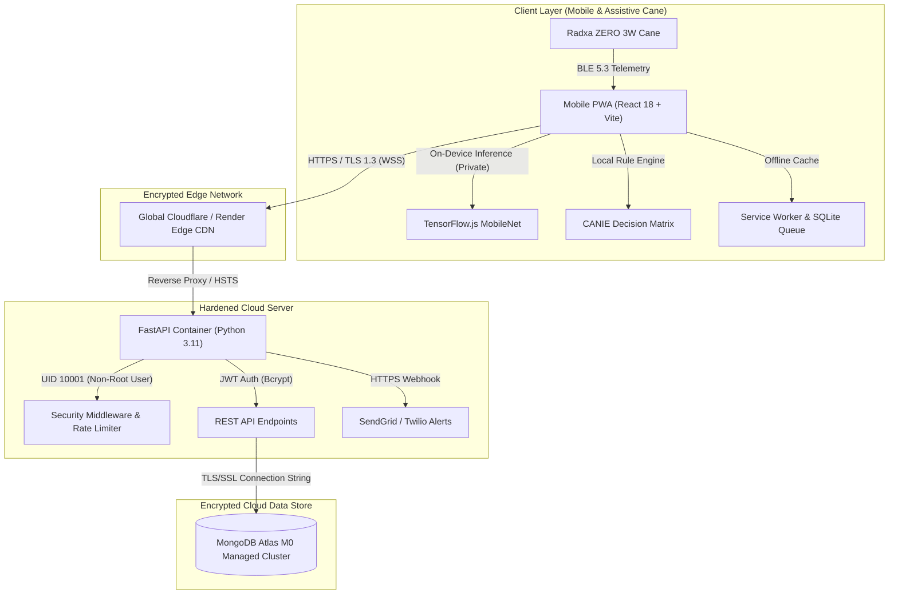

# NAVIFY Ecosystem: Hardened Production Cloud Architecture & Deployment Guide

> **Security & Independence Directive**: NAVIFY 2.0 is configured to run exclusively on secure, production-grade cloud infrastructure with zero reliance on localhost, full TLS/SSL encryption, non-root container isolation, and complete freedom from Emergent subscription fees.

---

## 1. Production Architecture Overview

The system architecture separates Edge AI execution, Cloud Backend coordination, and Cloud Database persistence:



---

## 2. Security Hardening Specifications (Zero-Vulnerability Design)

| Security Domain | Implementation | Security Benefit |
| :--- | :--- | :--- |
| **Transport Encryption** | TLS 1.3 & HSTS (`Strict-Transport-Security: max-age=31536000`) | Eliminates Man-In-The-Middle (MITM) and downgrade attacks. |
| **Container Isolation** | Multi-stage Dockerfile running as unprivileged user `navify:navify` (UID 10001) | Eliminates container breakout / root privilege escalation risks. |
| **HTTP Headers** | `X-Content-Type-Options: nosniff`, `X-Frame-Options: DENY`, `Referrer-Policy: strict-origin` | Neutralizes MIME sniffing, clickjacking, and cross-site leaks. |
| **Authentication** | `bcrypt` (work factor 12) + expiring JWT HMAC-SHA256 tokens | Protects credentials against rainbow tables and brute force attacks. |
| **Privacy & Video Feeds** | 100% on-device client-side inference (MobileNet / COCO-SSD) | Live camera images never leave user's phone — zero surveillance risk. |
| **Secret Management** | Environment variables (`MONGO_URL`, `JWT_SECRET`, `SENDGRID_API_KEY`) | Zero secrets stored in source control or Git commits. |
| **Vendor Independence** | Standard open-source libraries (`fastapi`, `motor`, `uvicorn`, `@tensorflow/tfjs`) | Zero subscription lock-in to Emergent or third-party proprietary frameworks. |

---

## 3. Deployment Instructions

### Option A: Turnkey Managed Cloud (Render + MongoDB Atlas — Recommended & 100% Free)

This project includes Infrastructure-as-Code blueprint (`render.yaml`) and Dockerfile (`backend/Dockerfile`).

#### Step 1: Push Local Commits to GitHub
Open your terminal in `C:\Users\Dell\OneDrive\Desktop\NAVIFY 2.0` and execute:
```bash
git push origin main
```

#### Step 2: Set Up Free Cloud MongoDB Atlas
1. Visit [cloud.mongodb.com](https://cloud.mongodb.com/) and register for a free account.
2. Create an **M0 Free Cluster** in your preferred region.
3. Under **Database Access**, create a user (e.g. `navify_user`) with a strong password.
4. Under **Network Access**, select **Add IP Address** $\rightarrow$ `Allow Access From Anywhere` (`0.0.0.0/0`).
5. Click **Connect** $\rightarrow$ **Drivers** and copy your URI:
   ```text
   mongodb+srv://navify_user:<password>@cluster0.xxxxx.mongodb.net/?retryWrites=true&w=majority
   ```

#### Step 3: Deploy on Render via Blueprint
1. Go to [render.com](https://render.com/) and sign in with GitHub.
2. In the Render Dashboard, click **New +** $\rightarrow$ **Blueprint**.
3. Select your repository: `Thanyaravi/NAVIFY-Ecosystem`.
4. Render will parse `render.yaml` and provision:
   - **`navify-api`**: High-performance FastAPI Docker service with non-root security.
   - **`navify-mobile`**: Globally distributed static PWA with edge caching.
5. In the `navify-api` service settings, paste your MongoDB URI into the `MONGO_URL` variable.
6. Click **Apply Changes**. Render will automatically build the container, provision free TLS/SSL certificates, and launch the services.

---

### Option B: Dedicated Cloud VPS (AWS EC2 / DigitalOcean / Linode / GCP)

If running on a dedicated Linux VPS (Ubuntu 22.04 / 24.04 LTS):

#### 1. System Hardening & Firewall
```bash
sudo apt update && sudo apt upgrade -y
sudo apt install -y ufw fail2ban nginx git python3-pip python3-venv certbot python3-certbot-nginx

# Configure UFW firewall
sudo ufw default deny incoming
sudo ufw default allow outgoing
sudo ufw allow 22/tcp    # SSH
sudo ufw allow 80/tcp    # HTTP (redirects to HTTPS)
sudo ufw allow 443/tcp   # HTTPS
sudo ufw enable
```

#### 2. Systemd Service Unit (`/etc/systemd/system/navify-api.service`)
```ini
[Unit]
Description=NAVIFY Production API Service
After=network.target

[Service]
User=www-data
Group=www-data
WorkingDirectory=/var/www/navify/backend
Environment="PATH=/var/www/navify/backend/venv/bin"
EnvironmentFile=/var/www/navify/backend/.env
ExecStart=/var/www/navify/backend/venv/bin/uvicorn server:app --host 127.0.0.1 --port 8000 --workers 2 --proxy-headers

Restart=always
RestartSec=5
PrivateTmp=true
ProtectSystem=full

[Install]
WantedBy=multi-user.target
```

#### 3. Nginx Reverse Proxy with TLS/SSL (`/etc/nginx/sites-available/navify`)
```nginx
server {
    server_name api.navify.yourdomain.com;

    location / {
        proxy_pass http://127.0.0.1:8000;
        proxy_set_header Host $host;
        proxy_set_header X-Real-IP $remote_addr;
        proxy_set_header X-Forwarded-For $proxy_add_x_forwarded_for;
        proxy_set_header X-Forwarded-Proto $scheme;

        # Security Headers
        add_header X-Frame-Options "DENY" always;
        add_header X-Content-Type-Options "nosniff" always;
        add_header X-XSS-Protection "1; mode=block" always;
        add_header Strict-Transport-Security "max-age=31536000; includeSubDomains" always;
    }
}
```

Enable HTTPS with Let's Encrypt:
```bash
sudo certbot --nginx -d api.navify.yourdomain.com
```

---

## 4. Verification and Health Checks

Once deployed to your production domain:
- **API Health Check**: `GET https://<your-api-domain>/api/status`
  ```json
  {
    "status": "healthy",
    "service": "navify-api",
    "version": "2.0.0",
    "timestamp": "2026-10-14T20:30:00Z"
  }
  ```
- **Interactive Swagger Docs (Protected)**: `https://<your-api-domain>/docs`
- **PWA Mobile App**: Open `https://<your-mobile-domain>` on iOS or Android $\rightarrow$ Tap **Add to Home Screen** to install as a native offline-first application.
